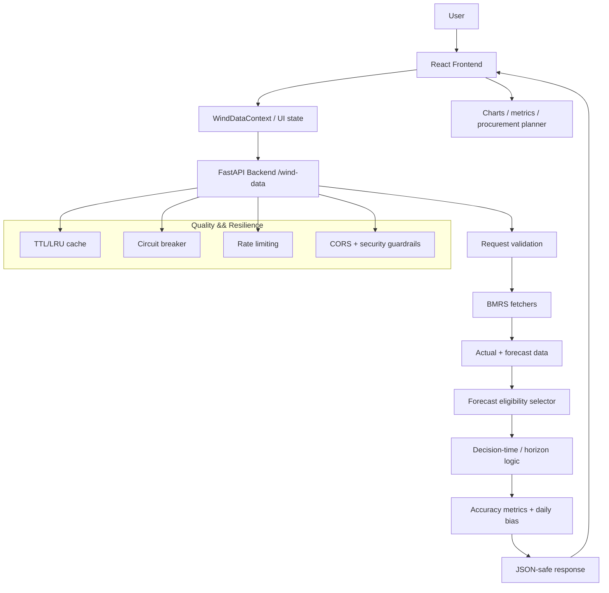

# Wind Forecast Monitor

A UK wind-generation forecasting and procurement support application built around live Elexon BMRS data. The system compares actual wind output with forecasted wind output, models a day-ahead decision window, and supports operational procurement planning by estimating residual demand, expected wind supply, and the amount of generation or balancing power that may need to be secured.

This repository implements a full stack solution:

- Python FastAPI backend for BMRS ingestion, filtering, validation, metrics, caching, and API exposure
- React frontend for operational dashboarding, charts, and procurement planning
- Docker Compose setup for local execution
- analysis notebook for exploratory model work
- client-facing guide in [USER_GUIDE.md](USER_GUIDE.md)

This project was developed with the support of Claude AI and Antigravity IDE to accelerate architecture work, logic refinement, code quality review, and documentation cleanup.

---

## Purpose

This is not a generic weather dashboard. It is a decision-support tool for procurement and operational planning in a realistic D-1 market context.

The application is designed to answer questions like:

- How much wind generation is expected for each 30-minute interval?
- Which forecast is valid at the decision time, and which is too late to use?
- How much demand remains after expected wind is considered?
- Is there a shortfall, surplus, or near-balanced position?
- How much energy or power should be purchased or hedged?

The core principle is that planning decisions happen at a known decision time, not by taking every latest forecast as if it were available in real time.

---

## High-level architecture



---

## System design

### 1. Data layer

The backend is responsible for retrieving BMRS actual generation and forecast data, normalizing it into a consistent structure, and providing a stable API contract to the frontend.

This includes:

- actual generation data (FUELHH)
- published forecast data (WINDFOR)
- time-window filtering
- data deduplication and merging
- JSON-safe response conversion

### 2. Decision logic layer

Forecast eligibility is enforced in the backend with a strict selection model.

There are two modes:

- decision mode: uses a fixed D-1 decision time, such as 09:00 UK time
- horizon mode: uses a fixed lead-time horizon, such as 24 hours

The key rule is that forecasts are only considered valid when they were published on or before the relevant cut-off. This prevents hindsight leakage and reflects a realistic procurement process.

### 3. Business logic layer

The procurement planning logic sits in the frontend utility layer rather than inside the components. This is intentional and important for quality.

Core formulas include:

- expected wind after bias adjustment
- residual = demand − expected wind − other generation
- requirement = max(residual, 0)
- surplus = max(−residual, 0)
- MWh conversion using 30-minute intervals

This keeps the logic testable and audit-friendly.

### 4. Presentation layer

The front-end renders:

- wind and actual series charts
- forecast accuracy metrics
- daily summary cards
- interval-level procurement table
- net requirement / surplus summary

It acts as a computational UI layer, not the source of the business rules.

---

## Repository structure

```text
wind-forecast-monitor/
├── backend/
│   ├── accuracy_metrics.py
│   ├── cache.py
│   ├── circuit_breaker.py
│   ├── data_fetcher.py
│   ├── Dockerfile
│   ├── forecast_selector.py
│   ├── main.py
│   ├── requirements-dev.txt
│   ├── requirements.txt
│   ├── test_accuracy_metrics.py
│   ├── test_api.py
│   ├── test_cache.py
│   ├── test_circuit_breaker.py
│   ├── test_decision_time.py
│   ├── test_forecast_selector.py
│   └── test_api.py
│
├── frontend/
│   ├── Dockerfile
│   ├── nginx.conf
│   ├── package.json
│   ├── build/
│   │   ├── asset-manifest.json
│   │   ├── index.html
│   │   ├── manifest.json
│   │   ├── robots.txt
│   │   └── static/
│   │       ├── css/
│   │       └── js/
│   ├── public/
│   │   ├── index.html
│   │   ├── manifest.json
│   │   └── robots.txt
│   └── src/
│       ├── App.css
│       ├── App.js
│       ├── App.test.js
│       ├── index.css
│       ├── index.js
│       ├── reportWebVitals.js
│       ├── setupTests.js
│       ├── components/
│       │   ├── ControlPanel.js
│       │   ├── ErrorBanner.js
│       │   ├── ErrorChart.js
│       │   ├── Header.js
│       │   ├── LoadingState.js
│       │   ├── MetricsPanel.js
│       │   ├── ProcurementPlanner.js
│       │   ├── ScenarioPanel.js
│       │   ├── StatCard.js
│       │   └── WindChart.js
│       ├── context/
│       │   ├── WindDataContext.js
│       │   └── WindDataContext.test.js
│       └── utils/
│           ├── dataTransforms.js
│           ├── dataTransforms.test.js
│           ├── procurementCalcs.js
│           └── procurementCalcs.test.js
│
├── analysis/
│   └── forecast_analysis.ipynb
├── docker-compose.yml
├── LICENSE
├── README.md
├── USER_GUIDE.md
├── .gitignore
└── .venv/
```

---

## Core feature map

### Forecast monitoring

The backend merges actual generation with forecast data and returns a normalized time series for each requested day or date range.

Features include:

- actual vs forecast comparison
- item-level time alignment
- missing-value handling
- date-range validation
- publishing-time filtering

### Decision-time forecast selection

This is one of the most important parts of the business logic.

At a fixed local time, the system decides which forecast is eligible for the delivery day. This matches the practical procurement model used in day-ahead decisioning.

Rules:

- same decision-time cutoff for all half-hour slots in a delivery day
- only forecasts published on or before the cutoff are eligible
- latest eligible forecast wins
- future data is excluded from the decision process

### Accuracy metrics

The backend computes accuracy metrics such as:

- mean absolute error (MAE)
- root mean squared error (RMSE)
- forecast bias
- coverage
- maximum shortfall
- number of valid observations

These are used for operational diagnosis and model quality checks.

### Procurement planner

The planner allows a user to define a demand profile and evaluate the likely needs after accounting for wind generation and other sources.

It calculates:

- expected wind by interval
- residual energy or power gap
- requirement and surplus
- daily net position
- interval-level requirement values

The output is structured to reflect real operational actions without hiding where shortfalls or surpluses occur.

### Missing values safeguard

The system makes a deliberate decision to preserve missing values rather than replacing them with zero.

This is strategically important because treating missing wind as zero can easily create false procurement signals and distort the model.

---

## How the business logic works

### 1. Data fetch and normalization

The backend requests:

- actual wind generation from BMRS FUELHH
- published forecast sets from BMRS WINDFOR

The data is standardized to a consistent UTC timestamp-based structure and merged by delivery slot.

### 2. Forecast selection by cutoff

Each forecast row has:

- target time
- publishTime
- forecast value

The selection logic determines whether a given forecast is eligible using a time cutoff, not by a simple latest-value rule.

In decision mode:

- the buyer has a decision time on D-1
- the cutoff is calculated for the full delivery day
- every slot shares the same decision checkpoint

This is more realistic than a per-slot lead-time model because a choice is made at a single operational moment.

### 3. Bias calculation

The system calculates a day-by-day bias using trailing historical data while excluding the current delivery day itself.

The key rule is:

- bias is measured only on information that was available at the decision checkpoint
- future values after the cutoff are not used in the calibration set

This prevents a hidden look-ahead effect in the estimate.

### 4. Residual and requirement calculation

For each interval, the logic then evaluates:

- demand
- expected wind
- other generation
- residual gap

When residual is positive, the system indicates a shortfall or requirement. When residual is negative, it indicates surplus.

This is done at interval resolution and summarized at the daily level.

### 5. MWh conversion

Since the market and delivery intervals are based on 30-minute blocks, power values are converted into MWh using:

- MWh = MW × 0.5 hours

That means each half-hour interval contributes a standardized energy value.

---

## Engineering decisions and quality practices

### Caching strategy

The backend uses a two-layer in-memory cache:

- L1 raw fetch cache: stores BMRS responses by date range
- L2 merged result cache: stores the merged + filtered result for a repeated request

Why this matters:

- repeated UI calls do not hit BMRS unnecessarily
- the expensive merge and selection operations are avoided for identical requests
- performance remains stable during repeated dashboard interaction

The cache is bounded with TTL and LRU behavior to avoid memory blow-up.

### Circuit breakers

The system wraps BMRS fetches with circuit-breaker logic.

This helps when upstream services are failing, slow, or unstable. Instead of collapsing under repeated retries, the service enters a fail-safe mode and returns predictable degraded behaviour.

### Rate limiting

The API uses rate limiting to avoid abuse and to protect upstream BMRS services from being overwhelmed by repeated requests.

Key protection points:

- per-client limit
- global limit backstop
- forwarded-IP handling for proxied deployment environments

This is important for both service resilience and operational stability.

### CORS and security boundary

The backend is configured with explicit CORS rules and request validation. This prevents unintended cross-origin access and keeps the public API boundary controlled.

### JSON-safe responses

The backend sanitizes output before sending it to the frontend. This prevents NaN and invalid JSON values from causing runtime errors in the browser or downstream systems.

### Graceful degradation

When critical data is missing, the app does not silently invent values.

Instead it:

- keeps values as missing where appropriate
- marks unavailable forecast data
- preserves data integrity
- avoids false zero substitutions

This is a major operational safety pattern in the codebase.

### Separation of concerns

The system is intentionally split into:

- backend data orchestration
- forecasting logic
- business logic utilities
- React components
- data context and state management

This makes the system easier to reason about, test, and extend.

---

## Performance and optimization notes

### Vectorized pandas logic

Forecast selection is implemented using pandas operations rather than nested Python loops. This is substantially faster and more stable for multi-day ranges.

Benefits:

- lower CPU cost
- predictable behaviour on larger date windows
- easier maintainability
- reduced risk of N+1 style computational patterns

### Parallel fetch logic

The backend fetches actual and forecast data in parallel when needed. This shortens latency when multiple upstream requests are required.

### Frontend state design

The React app uses a provider and reducer-based model rather than a heavier state framework. This keeps the UI simple while still supporting proper state transitions for loading, error, and successful fetch states.

### Static frontend build

The frontend is prepared as a production static build and can be served through a lightweight static host or reverse proxy.

---

## Local execution

### Option 1: Local Python + React

#### Backend

```bash
cd backend
python3 -m venv .venv
source .venv/bin/activate
pip install -r requirements-dev.txt
uvicorn main:app --reload --host 0.0.0.0 --port 8000
```

#### Frontend

```bash
cd frontend
npm install
npm start
```

Then open:

- backend: http://localhost:8000
- frontend: http://localhost:3000
- Swagger docs: http://localhost:8000/docs

### Option 2: Docker Compose

From the project root:

```bash
docker compose up --build
```

Then open:

- backend: http://localhost:8000
- frontend: http://localhost:3001

Useful docker commands:

```bash
docker compose down
docker compose logs -f backend
docker compose logs -f frontend
docker compose ps
```

---

## Environment configuration

### Frontend

```bash
REACT_APP_API_URL=http://127.0.0.1:8000
```

### Backend

```bash
ALLOWED_ORIGINS=http://localhost:3000,https://your-frontend-domain.com
RATE_LIMIT=30/minute
GLOBAL_RATE_LIMIT=300/minute
CACHE_TTL_SECONDS=600
TRUSTED_PROXY_COUNT=0
```

Important note:

- do not append a trailing slash to the backend origin in production
- the app should use a clean origin such as `https://api.example.com`, not `https://api.example.com/`

---

## Testing

### Backend test suite

```bash
cd backend
source .venv/bin/activate
python -m pytest -q
```

Covered areas include:

- validation logic
- forecast selector correctness
- D-1 cutoff logic
- metrics correctness
- cache behaviour
- circuit-breaker failure handling
- API response safety

### Frontend tests

```bash
cd frontend
CI=true npm test -- --watch=false --runInBand
```

The frontend unit tests cover the procurement utility layer and key transformation logic.

---

## Deployment guidance

Recommended stack:

- Frontend: Vercel
- Backend: Render free tier, Railway, or another Python container host

Render deployment note:

- the backend can be deployed on Render using a Python service or container
- on the free tier, the service may cold-start and can take roughly 20–30 seconds to respond on the first request after inactivity
- this is normal on free-tier hosting and should be accounted for when testing the live deployment
- after the first wake-up request, the service usually responds faster until the next idle period

Production requirements:

- set `REACT_APP_API_URL` to the deployed backend origin
- configure backend `ALLOWED_ORIGINS` for the frontend domain
- keep the backend behind a managed proxy if necessary
- ensure HTTP and HTTPS settings are consistent

This project is built in a split-stack pattern so it is straightforward to deploy with standard modern cloud tooling.

---

## Known strengths

- realistic D-1 decision-time model
- strict forecast publication cutoff
- missing-data handling that avoids false zero assumptions
- clear separation between API, forecasting logic, and presentation
- resilience patterns for upstream outage scenarios
- isolated business logic for testability and auditability
- production-friendly deployment structure

---

## Current limitations

- no authentication or user roles are implemented
- CI/CD is not yet fully packaged as a production pipeline
- BMRS reliance means downstream performance depends on upstream service behaviour
- the planner is tuned for operational procurement workflow rather than generalized portfolio optimization

---

## AI-assisted development note

This project was developed with the support of Claude AI for code reasoning, architecture validation, logic review, and documentation refinement, and used Antigravity IDE as the development environment for iterative edits and validation.

This does not change the engineering intent of the codebase; it simply accelerated the design, debugging, audit, and documentation cycles.

---

## User guide

For a client-friendly explanation of the business logic and procurement view, see [USER_GUIDE.md](USER_GUIDE.md).

---

## Summary

This project combines:

- live BMRS actual and forecast ingestion
- realistic D-1 decision-time logic
- operational bias correction and missing-data safeguards
- backend resilience primitives like caching, circuit breakers, and rate limits
- a clean split between business logic, API logic, and UI rendering
- a testable and audit-friendly architecture for procurement and forecasting decisions

It is designed to support a practical question: after accounting for wind, demand, and other visible generation, how much additional power must be secured at the decision point?
